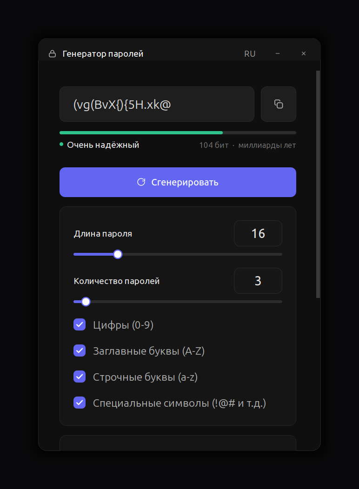

<div align="center">

# 🔐 PastyNew Password Generator

**Offline password generator with a modern dark interface.**

[](https://www.python.org/)
[](https://www.qt.io/)
[](LICENSE)
[](https://github.com/PastyNew/pastypw/actions/workflows/build.yml)
[](#creator)

[](https://github.com/PastyNew/pastypw/releases)
[](https://github.com/PastyNew/pastypw/releases)

**Русская версия: [README.md](README.md)**

</div>

---

## 📸 Interface


<div align="center">
  
  
</div>

---

## 👤 Creator

Written, designed and packaged by **PastyNew** — algorithm, interface and every
build script in this repository.

* No telemetry, no servers, no advertising.
* MIT licensed application code; Qt/PySide6 is LGPL 3.0.

---

## ✨ Features

| Feature | Description |
|---|---|
| 🔒 Cryptographic strength | Randomness comes from `secrets` (the OS CSPRNG), never from `random` |
| 🎚 Length | Slider plus numeric field, 4 to 64 characters |
| 🔣 Character sets | Digits, uppercase, lowercase and symbols - toggle them freely |
| ✅ Class guarantee | Every password contains at least one character from each enabled class |
| ⚡ Batch mode | Up to 50 unique passwords per click, copy one or all of them |
| 📊 Strength estimate | Entropy in bits, colour scale and estimated crack time |
| 🕘 History | Local history, favourites (☆), reveal/hide, delete and `.txt` export |
| 🌐 Two languages | Russian and English, switch with the `RU`/`EN` button or `Ctrl+L` |
| 🖥 Beautiful window | Rounded corners, soft shadow, custom title bar, dark theme |
| ⌨️ Shortcuts | `Enter`/`Ctrl+G` generate, `Ctrl+C` copy, `Ctrl+L` language, `Ctrl+E` export |
| 📦 Packages | `.deb`, `.rpm`, `.pkg.tar.zst` (Arch/Kali), AppImage and Windows `.exe` |

---

## 📦 Installation

Grab a ready-made package from the releases page:
**<https://github.com/PastyNew/pastypw/releases>**

> Release packages are built inside Debian 12, so they run on Debian 12+,
> Ubuntu 22.04+, Fedora 35+, Arch and Kali. A package you build yourself is
> tied to your own glibc version — see [docs/BUILD.md](docs/BUILD.md).

### 🐧 Ubuntu / Debian / Mint / Kali (`.deb`)

```bash
sudo dpkg -i pastypw_1.0.0_amd64.deb
# if dependencies are missing:
sudo apt install -f
```

### 🐧 Fedora / RHEL / openSUSE (`.rpm`)

```bash
sudo dnf install ./pastypw-1.0.0-1.x86_64.rpm
```

### 🐧 Arch Linux / Manjaro / Kali (`.pkg.tar.zst`)

```bash
sudo pacman -U pastypw-1.0.0-1-x86_64.pkg.tar.zst
```

### 🐧 Any Linux (AppImage)

```bash
chmod +x pastypw-1.0.0-x86_64.AppImage
./pastypw-1.0.0-x86_64.AppImage
```

### 🪟 Windows (`.exe`)

* `PastyNew-PasswordGenerator-Setup-1.0.0.exe` — regular installer with desktop
  and Start menu shortcuts, removable through "Apps & features".
* `pastypw.exe` — portable build: copy it anywhere and run it.

> SmartScreen may warn about an "unknown publisher" because the binary is not
> signed with a personal certificate. Choose **More info → Run anyway**.

### 🧪 Run from sources

```bash
git clone https://github.com/PastyNew/pastypw.git
cd pastypw
python3 -m venv .venv
. .venv/bin/activate
pip install -r requirements.txt
python -m pastypw
```

Qt runtime libraries on a bare Linux box:

```bash
sudo apt install libgl1 libegl1 libxkbcommon0 libxkbcommon-x11-0 libdbus-1-3 libfontconfig1
```

---

## ⌨️ Keyboard shortcuts

| Keys | Action |
|---|---|
| `Enter`, `Ctrl+G` | Generate |
| `Ctrl+C` | Copy the current password (double-clicking the field works too) |
| `Ctrl+L` | Toggle language (RU / EN) |
| `Ctrl+E` | Export generated passwords to `.txt` |
| `←` `→`, mouse wheel | Change the password length |

---

## 🧮 How the strength estimate works

```
entropy = length × log2(alphabet size)
```

Alphabet size with every set enabled: 10 digits + 26 uppercase + 26 lowercase
+ 32 symbols = **94 characters**.

Crack time assumes a *fast* offline attack (10<sup>10</sup> guesses per second,
a typical GPU hash-cracking rig) - a pessimistic but honest number.

| Length (all sets) | Entropy | Rough crack time |
|---|---|---|
| 8 | 52 bits | seconds |
| 12 | 79 bits | months |
| 16 | 104 bits | billions of years |
| 24 | 157 bits | heat death of the universe |

---

## 🗂 Where the data lives

| What | Path |
|---|---|
| Settings | `~/.config/pastypw/settings.json` |
| History & favourites | `~/.local/share/pastypw/history.json` |

The history file is **plain text and not encrypted** - a deliberate trade-off so
that it can be exported. On a shared machine clear it with the bin icon in the
history card. See [SECURITY.md](SECURITY.md).

---

## 🛠 Building from sources

```bash
make venv        # environment with PySide6 and PyInstaller
make test        # unit tests
make all         # tests + icons + frozen app + .deb + AppImage
```

Individual targets:

| Command | Result |
|---|---|
| `make linux-binary` | frozen application in `dist/pastypw` |
| `make deb` | `.deb` package (needs `dpkg-deb`) |
| `make rpm` | `.rpm` package (needs `rpmbuild`) |
| `make arch` | `.pkg.tar.zst` (needs `makepkg`) |
| `make appimage` | portable AppImage |
| `make icons` | application icons into `build/icons` |
| `make screenshots` | README screenshots (headless) |

Windows:

```powershell
powershell .\scripts\build_windows.ps1
```

Or build **everything** with GitHub Actions: every push and tag runs
[build.yml](.github/workflows/build.yml); the files show up under
**Actions → Artifacts**, and tagging `v1.0.0` publishes them in **Releases**.

---

## 🧱 Project layout

```
pastypw/
├── pastypw/
│   ├── core/            # Qt-free logic: generation, strength, storage
│   │   ├── generator.py
│   │   ├── strength.py
│   │   └── storage.py
│   └── ui/              # theme, i18n, icons, widgets, window
├── tests/               # 26 unit tests
├── scripts/             # package builders, icons, screenshots
├── packaging/           # .desktop, RPM spec, PKGBUILD, NSIS, PyInstaller
└── docs/                # images and step-by-step guides
```

---

## ❓ FAQ

**The window is blank / white.**
A working graphics driver is required (the app is a Qt application). Make sure
`libgl1` and `libegl1` are installed and run it on Wayland or X11.

**Copying does not work.**
Some Wayland compositors grant clipboard access only while the app is focused.
Use the `.txt` export instead (down-arrow icon).

**How do I wipe the history?**
Bin icon in the "History" card, or delete
`~/.local/share/pastypw/history.json` by hand.

**Is it really secure?**
Generation goes through the OS CSPRNG and the application never touches the
network. Details in [SECURITY.md](SECURITY.md).

---

## 📄 License

MIT - see [LICENSE](LICENSE). Qt 6 / PySide6 are LGPL 3.0.

---

## 📚 Documentation

* [docs/GITHUB_UPLOAD.md](docs/GITHUB_UPLOAD.md) - how to publish this project on GitHub properly
* [docs/BUILD.md](docs/BUILD.md) - full build guide for every format
* [CHANGELOG.md](CHANGELOG.md) - release history
* [CONTRIBUTING.md](CONTRIBUTING.md) - how to contribute
* [SECURITY.md](SECURITY.md) - security policy

<div align="center">

**Creator of the password generator — PastyNew** © 2026

</div>