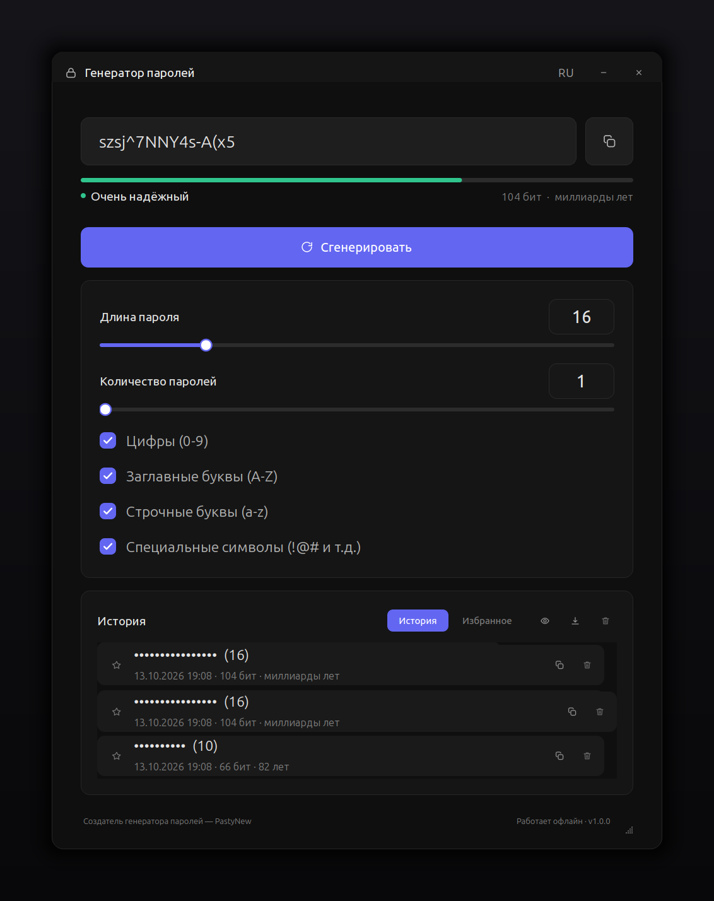
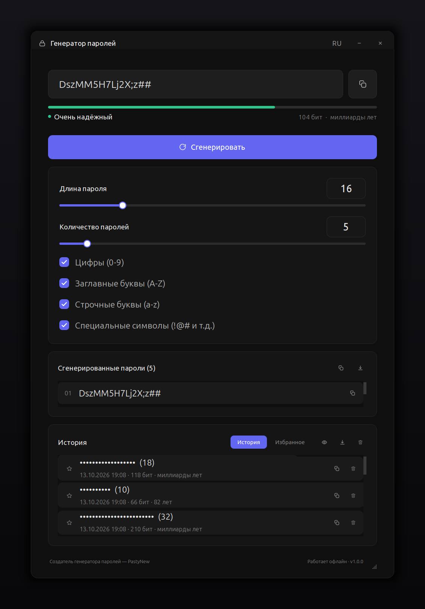
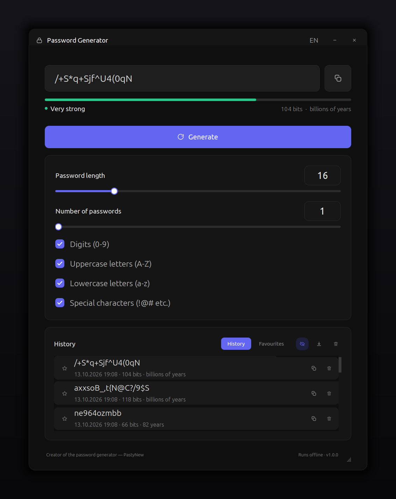

<div align="center">

# 🔐 PastyNew Password Generator

**Офлайн-генератор паролей с современным тёмным интерфейсом.**

[](https://www.python.org/)
[](https://www.qt.io/)
[](LICENSE)
[](https://github.com/PastyNew/pastypw/actions/workflows/build.yml)
[](#автор)

[](https://github.com/PastyNew/pastypw/releases)
[](https://github.com/PastyNew/pastypw/releases)

**English version: [README.en.md](README.en.md)**

</div>

---

## 📸 Интерфейс



<div align="center">
  
  
</div>

---

## 👤 Автор

Проект создан и полностью написан **PastyNew** — генератор, алгоритм, дизайн
интерфейса и все скрипты сборки пакетов.

* Никакой телеметрии, никаких серверов, никакой рекламы.
* Авторские права: [MIT License](LICENSE). Qt/PySide6 — LGPL 3.0.

---

## ✨ Возможности

| Возможность | Описание |
|---|---|
| 🔒 Криптостойкость | Случайность берётся из `secrets` (CSPRNG операционной системы), а не из `random` |
| 🎚 Длина | Слайдер и числовое поле: от 4 до 64 символов |
| 🔣 Наборы символов | Цифры, заглавные, строчные и специальные символы — включаются галочками |
| ✅ Гарантия классов | В каждом пароле есть минимум одна цифра, одна заглавная, одна строчная и один спецсимвол (если длина позволяет) |
| ⚡ Пакетная генерация | До 50 уникальных паролей за один клик, копирование по одному или всех сразу |
| 📊 Оценка стойкости | Энтропия в битах, цветная шкала и прогноз времени взлома |
| 🕘 История | Локальная история, избранное (☆), показ/скрытие, удаление, экспорт в `.txt` |
| 🌐 Два языка | Русский и английский, переключение кнопкой `RU`/`EN` или `Ctrl+L` |
| 🖥 Красивое окно | Скруглённые углы, мягкая тень, свой тайтл-бар, тёмная тема |
| ⌨️ Горячие клавиши | `Enter` / `Ctrl+G` — сгенерировать, `Ctrl+C` — копировать, `Ctrl+L` — язык, `Ctrl+E` — экспорт |
| 📦 Пакеты | `.deb`, `.rpm`, `.pkg.tar.zst` (Arch/Kali), `AppImage`, `.exe` для Windows |

---

## 📦 Установка

Скачайте готовый пакет со страницы релизов:
**<https://github.com/PastyNew/pastypw/releases>**

> Пакеты в Releases собираются в Debian 12, поэтому работают на Debian 12+,
> Ubuntu 22.04+, Fedora 35+, Arch и Kali. Если вы собираете пакет сами на
> своём компьютере, он будет привязан к вашей версии glibc — подробности
> в [docs/BUILD.md](docs/BUILD.md).

### 🐧 Ubuntu / Debian / Mint / Kali (`.deb`)

```bash
sudo dpkg -i pastypw_1.0.0_amd64.deb
# если есть зависимости:
sudo apt install -f
```

Удаление:

```bash
sudo apt remove pastypw
```

### 🐧 Fedora / RHEL / openSUSE (`.rpm`)

```bash
sudo dnf install ./pastypw-1.0.0-1.x86_64.rpm
# или
sudo rpm -Uvh pastypw-1.0.0-1.x86_64.rpm
```

### 🐧 Arch Linux / Manjaro / Kali (`.pkg.tar.zst`)

```bash
sudo pacman -U pastypw-1.0.0-1-x86_64.pkg.tar.zst
```

### 🐧 Любой Linux (AppImage)

```bash
chmod +x pastypw-1.0.0-x86_64.AppImage
./pastypw-1.0.0-x86_64.AppImage
```

### 🪟 Windows (`.exe`)

* `PastyNew-PasswordGenerator-Setup-1.0.0.exe` — обычный установщик
  (ярлыки на рабочем столе и в меню «Пуск», удаление через «Панель управления»).
* `pastypw.exe` — портативная версия: скопируйте в любую папку и запустите.

> SmartScreen может показать предупреждение «неизвестный издатель» — это
> потому что пакет не подписан личным сертификатом. Нажмите
> **Подробнее → Выполнить в любом случае**.

### 🧪 Запуск из исходников

```bash
git clone https://github.com/PastyNew/pastypw.git
cd pastypw
python3 -m venv .venv
. .venv/bin/activate
pip install -r requirements.txt
python -m pastypw
```

Нужны Python 3.9+ и PySide6. На «голом» Linux может понадобиться
доустановить системные библиотеки Qt:

```bash
sudo apt install libgl1 libegl1 libxkbcommon0 libxkbcommon-x11-0 libdbus-1-3 libfontconfig1
```

---

## ⌨️ Горячие клавиши

| Клавиши | Действие |
|---|---|
| `Enter`, `Ctrl+G` | Сгенерировать пароль |
| `Ctrl+C` | Скопировать текущий пароль (также работает двойной клик по полю) |
| `Ctrl+L` | Переключить язык (RU / EN) |
| `Ctrl+E` | Экспорт сгенерированных паролей в `.txt` |
| `←` `→`, колесо мыши | Изменить длину пароля |

---

## 🧮 Как считается стойкость

Энтропия одного случайного пароля:

```
энтропия = длина × log2(размер алфавита)
```

Размер алфавита: 10 цифр + 26 заглавных + 26 строчных + 32 спецсимвола =
**94 символа**, если включены все наборы.

Прогноз времени взлома считается для «быстрой» атаки — 10<sup>10</sup>
проверок в секунду (типичный перебор хешей на GPU). Это пессимистичная,
но честная оценка.

| Длина (все наборы) | Энтропия | Примерный взлом |
|---|---|---|
| 8 | 52 бита | секунды |
| 12 | 79 бит | месяцы |
| 16 | 104 бита | миллиарды лет |
| 24 | 157 бит | тепловая смерть Вселенной |

---

## 🗂 Где лежат данные

| Что | Путь |
|---|---|
| Настройки | `~/.config/pastypw/settings.json` |
| История и избранное | `~/.local/share/pastypw/history.json` |

История хранится **открытым текстом** и не шифруется — это осознанное
решение, чтобы её можно было экспортировать. На общем компьютере
очищайте историю кнопкой с мусорным бачком. Подробности — в
[SECURITY.md](SECURITY.md).

---

## 🛠 Сборка из исходников

```bash
make venv        # окружение с PySide6 и PyInstaller
make test        # тесты
make all         # тесты + иконки + бинарник + .deb + AppImage
```

Отдельно:

| Команда | Что делает |
|---|---|
| `make linux-binary` | замороженное приложение в `dist/pastypw` |
| `make deb` | пакет `.deb` (нужен `dpkg-deb`) |
| `make rpm` | пакет `.rpm` (нужен `rpmbuild`) |
| `make arch` | пакет `.pkg.tar.zst` (нужен `makepkg`) |
| `make appimage` | портативный AppImage |
| `make icons` | иконки приложения в `build/icons` |
| `make screenshots` | скриншоты для README (без графики) |

Windows:

```powershell
powershell .\scripts\build_windows.ps1
```

Либо соберите **все** форматы через GitHub Actions: каждый push и каждый тег
запускает [build.yml](.github/workflows/build.yml), готовые файлы лежат в
разделе **Actions → Artifacts**, а по тегу `v1.0.0` — в **Releases**.

---

## 🧱 Структура проекта

```
pastypw/
├── pastypw/
│   ├── core/            # логика без Qt: генерация, стойкость, хранилище
│   │   ├── generator.py
│   │   ├── strength.py
│   │   └── storage.py
│   └── ui/              # интерфейс: тема, переводы, иконки, виджеты, окно
├── tests/               # 26 юнит-тестов
├── scripts/             # сборка пакетов, иконки, скриншоты
├── packaging/           # .desktop, RPM spec, PKGBUILD, NSIS, PyInstaller
└── docs/                # изображения и пошаговые инструкции
```

---

## ❓ Частые вопросы

**Окно белое / ничего не видно?**
Нужен видеодрайвер: приложение использует Qt. Проверьте, что установлены
`libgl1` и `libegl1`, и запустите его на Wayland или X11.

**Пароль не копируется?**
На некоторых Wayland-окружениях clipboard работает только пока приложение
открыто. Используйте экспорт в `.txt` (иконка со стрелкой вниз).

**Как удалить историю?**
Кнопка с мусорным бачком в карточке «История». Файлы можно удалить вручную:
`rm -f ~/.local/share/pastypw/history.json`.

**Это безопасно?**
Генерация идёт через CSPRNG операционной системы, сеть не используется
вообще. Подробности — в [SECURITY.md](SECURITY.md).

---

## 📄 Лицензия

MIT — см. [LICENSE](LICENSE). Qt 6 / PySide6 распространяются под LGPL 3.0.

---

## 📚 Документация

* [docs/GITHUB_UPLOAD.md](docs/GITHUB_UPLOAD.md) — как грамотно залить проект на GitHub
* [docs/BUILD.md](docs/BUILD.md) — подробная инструкция по сборке всех форматов
* [CHANGELOG.md](CHANGELOG.md) — история изменений
* [CONTRIBUTING.md](CONTRIBUTING.md) — как contributing-ить
* [SECURITY.md](SECURITY.md) — политика безопасности

<div align="center">

**Создатель генератора паролей — PastyNew** © 2026

</div>